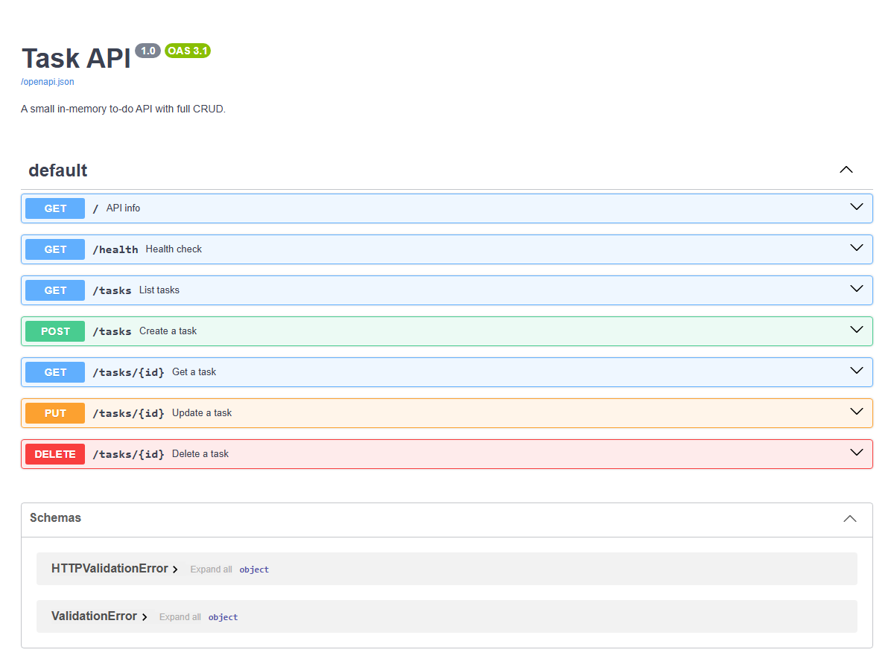

# Task API

A small to-do REST API built with [FastAPI](https://fastapi.tiangolo.com/). It supports full CRUD (create, read, update, delete) on tasks, validates input, and returns proper HTTP status codes. Interactive docs come for free via Swagger UI.

Every error response is JSON with an `error` message, e.g. `{"error": "Task 99 not found."}`.

Tasks are kept in memory, so the list resets to three sample tasks every time the server restarts.

## Requirements

- Python 3.10 or newer
- `git`

## Install & run

```bash
git clone https://github.com/kwibuloy/Flyrank_Week2.git
cd Flyrank_Week2
```

Then start the API with one command:

```bash
pip install -r requirements.txt && python -m uvicorn main:app --reload
```

The API is now running at http://localhost:8000 and the interactive docs are at http://localhost:8000/docs.

Optional: use a virtual environment first (`python -m venv .venv`, then `.venv\Scripts\activate` on Windows or `source .venv/bin/activate` on macOS/Linux).

## Endpoints

| Method | Path          | Description                          | Success | Errors |
|--------|---------------|--------------------------------------|---------|--------|
| GET    | `/`           | API name, version and endpoints      | `200`   |        |
| GET    | `/health`     | Health check                         | `200`   |        |
| GET    | `/tasks`      | List all tasks                       | `200`   |        |
| GET    | `/tasks/{id}` | Get one task                         | `200`   | `404` unknown id |
| POST   | `/tasks`      | Create a task from `{"title": "..."}`| `201`   | `400` invalid body or missing/empty title |
| PUT    | `/tasks/{id}` | Replace `title` and/or `done`        | `200`   | `400` empty/invalid body, `404` unknown id |
| DELETE | `/tasks/{id}` | Delete a task (empty body)           | `204`   | `404` unknown id |

A task looks like this:

```json
{ "id": 1, "title": "Workout", "done": false }
```

## Example

```bash
curl -i -X POST http://localhost:8000/tasks -H "Content-Type: application/json" -d '{"title":"Buy milk"}'
```

```
HTTP/1.1 201 Created
server: uvicorn
content-length: 40
content-type: application/json

{"id":4,"title":"Buy milk","done":false}
```

More calls to try:

```bash
curl -i -X PUT http://localhost:8000/tasks/4 -H "Content-Type: application/json" -d '{"done":true}'
curl -i -X DELETE http://localhost:8000/tasks/4
curl -i http://localhost:8000/tasks
```

On Windows PowerShell, use `curl.exe` instead of `curl` and escape the inner quotes, e.g. `-d '{\"title\":\"Buy milk\"}'`.

## Swagger UI

Open http://localhost:8000/docs, expand any endpoint, click **Try it out**, then **Execute** to send a real request.


