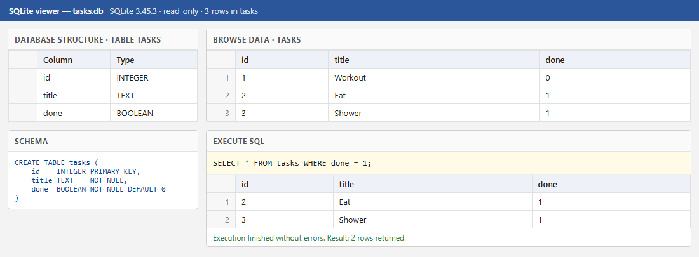

# Task API

A small to-do REST API built with [FastAPI](https://fastapi.tiangolo.com/). It supports full CRUD (create, read, update, delete) on tasks, validates input, and returns proper HTTP status codes. Interactive docs come for free via Swagger UI.

Every error response is JSON with an `error` message, e.g. `{"error": "Task 99 not found."}`.

Tasks are stored in a SQLite database, so they survive server restarts. The API (URLs, request bodies and responses) is exactly the same as the in-memory version from Assignment 1; only the storage changed.

## Why SQLite

- **Zero setup.** SQLite is built into Python (`import sqlite3`), so there is no database server to install, configure or keep running.
- **One file.** The whole database is a single file you can copy, delete or open in a viewer.
- **Real SQL.** It is a proper relational database, so the queries learned here (`SELECT`, `INSERT`, `UPDATE`, `DELETE`) carry over to PostgreSQL or MySQL later.
- **Right size.** A small single-user to-do API doesn't need anything bigger.

## Where the database lives

The database file is `tasks.db`, in the project folder next to `main.py` (the path is built from `main.py`'s own location, so it doesn't matter which folder you start the server from).

You don't create it yourself. Every time the server starts it:

1. creates `tasks.db` if the file is missing,
2. creates the `tasks` table if it doesn't exist,
3. inserts three example tasks, but only if the table is empty.

```sql
CREATE TABLE IF NOT EXISTS tasks (
    id    INTEGER PRIMARY KEY,
    title TEXT    NOT NULL,
    done  BOOLEAN NOT NULL DEFAULT 0
);
```

SQLite stores `done` as `0`/`1`; the API turns it back into `false`/`true`. `tasks.db` is listed in `.gitignore`, so each clone starts with a fresh database. To reset to the example tasks, stop the server, delete `tasks.db` and start it again.

## Requirements

- Python 3.10 or newer
- `git`

## How to start the project

```bash
git clone https://github.com/kwibuloy/Flyrank_Week2.git
cd Flyrank_Week2
```

Then start the API with one command:

```bash
pip install -r requirements.txt && python -m uvicorn main:app --reload
```

The API is now running at http://localhost:8000 and the interactive docs are at http://localhost:8000/docs. On first start `tasks.db` is created automatically with three example tasks.

Optional: use a virtual environment first (`python -m venv .venv`, then `.venv\Scripts\activate` on Windows or `source .venv/bin/activate` on macOS/Linux).

## Endpoints

| Method | Path          | Description                          | Success | Errors |
|--------|---------------|--------------------------------------|---------|--------|
| GET    | `/`           | API name, version and endpoints      | `200`   |        |
| GET    | `/health`     | Health check                         | `200`   |        |
| GET    | `/tasks`      | List all tasks                       | `200`   |        |
| GET    | `/tasks/{id}` | Get one task                         | `200`   | `404` unknown id |
| POST   | `/tasks`      | Create a task from `{"title": "..."}`| `201`   | `400` invalid body or missing/empty title |
| PUT    | `/tasks/{id}` | Replace `title` and/or `done`        | `200`   | `400` empty/invalid body, `404` unknown id |
| DELETE | `/tasks/{id}` | Delete a task (empty body)           | `204`   | `404` unknown id |

A task looks like this:

```json
{ "id": 1, "title": "Workout", "done": false }
```

## Example

```bash
curl -i -X POST http://localhost:8000/tasks -H "Content-Type: application/json" -d '{"title":"Buy milk"}'
```

```
HTTP/1.1 201 Created
server: uvicorn
content-length: 40
content-type: application/json

{"id":4,"title":"Buy milk","done":false}
```

More calls to try:

```bash
curl -i -X PUT http://localhost:8000/tasks/4 -H "Content-Type: application/json" -d '{"done":true}'
curl -i -X DELETE http://localhost:8000/tasks/4
curl -i http://localhost:8000/tasks
```

On Windows PowerShell, use `curl.exe` instead of `curl` and escape the inner quotes, e.g. `-d '{\"title\":\"Buy milk\"}'`.

## Swagger UI

Open http://localhost:8000/docs, expand any endpoint, click **Try it out**, then **Execute** to send a real request.


## Exploring the database with SQL

You can open `tasks.db` in any SQLite viewer, such as [DB Browser for SQLite](https://sqlitebrowser.org/) (**Open Database**, then the **Execute SQL** tab). All the queries I ran are in [`queries.sql`](queries.sql).

I ran them with Python's built-in `sqlite3` module, so nothing extra had to be installed. The screenshot below is a read-only viewer page generated from the real `tasks.db` with `sqlite3` and captured with headless Microsoft Edge. It shows the table structure, the stored schema, every row, and the result of `SELECT * FROM tasks WHERE done = 1;`.



Example query I executed, marking every task as completed:

```sql
UPDATE tasks SET done = 1;
```

It changed 6 rows. Right after it ran, `GET /tasks` returned all six tasks with `"done": true`, with no server restart, because each request reads straight from the database. Running `DELETE FROM tasks WHERE done = 1;` next made `GET /tasks` return `[]`.

In DB Browser, changes are only saved to the file after you click **Write Changes** (Ctrl+S), so the API sees them from that point on.
